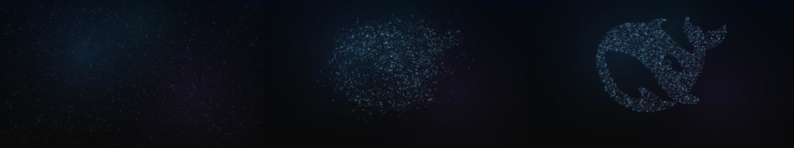

# DeepSeek 鲸鱼粒子聚合

粒子从散落聚合成品牌鲸鱼 Logo，适合片头、品牌露出或章节转场。

**16:9 · 1920 × 1080 · 30 fps · v1.1.0** · [@thepandaq](https://motiongit.com/@thepandaq) · [English](README.md)

**[模板详情、完整 .motion 与 Demo](https://motiongit.com/@thepandaq/deepseek-whale-assemble)**
https://motiongit.com/@thepandaq/deepseek-whale-assemble

下载已开放，当前许可见模板页面与下载包。

## Demo

[查看完整样片](https://motiongit.com/@thepandaq/deepseek-whale-assemble) · [播放视频](https://media.openaicut.com/previews/628/1.1.0-e0d9c9e4a5b8.mp4)

## 技术原理

- 声明的运行配置：html-canvas/1。
- 通过模板参数和预设，将本期文字、数据或素材映射到已有动画工程。
- 已声明时间轴为固定时长，本期内容按现有场景顺序和节奏适配。

样片时长: **8s**. 已声明输出为 1920 × 1080，30 fps；公开样片 8 秒。 按实际包的参数边界制作；增加素材不会自动增加场景。

## 输入素材与内容

- **必需:** Label：文字，不超过 24 个字符。
- **可选:** Accent：文字。

适用内容: 品牌片头 · 产品发布开场 · 章节转场

## 运行环境

- 声明的运行配置：html-canvas/1。具体工具与版本以下载包为准。
- 按下载包的依赖锁和 setup/check 说明检查已有工具，只补齐缺项，并验证预览。

## 使用模板

1. 从[模板页面](https://motiongit.com/@thepandaq/deepseek-whale-assemble)获取当前版本的完整 .motion。
2. 按包内说明解压或加载，读取 README 和引用的制作指南。
3. 使用本期内容与素材，复用已有环境，按包内入口制作并查看实际预览。

可将下面这段请求与仓库地址交给助手：

> https://github.com/motiontemplates/404937
>
> 请使用这个 .motion 模板制作。模板地址：https://motiongit.com/@thepandaq/deepseek-whale-assemble。取得模板后按其说明解压或加载，读取包内 README 和引用的指南，复用已有环境，用我的内容制作并展示实际预览。

## .motion 格式

MotionGit .motion 是可复用的视频模板格式，组织动画工程、参数、素材、依赖与制作指南。运行时按本期内容再次制作，输出 MP4 等成片。 [格式说明](https://motiongit.com/spec)

[版本、许可与完整下载](https://motiongit.com/@thepandaq/deepseek-whale-assemble) · [制作参考](ASSISTANT.zh-CN.md)
